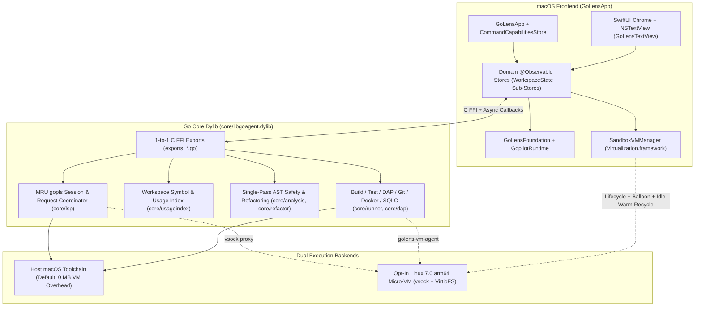

# GoLens Architecture

GoLens is a native macOS IDE for Go on Apple Silicon (`arm64`), built with a SwiftUI/AppKit frontend (`desktop/`), a pure Swift foundation & Gopilot runtime (`Sources/GoLensFoundation/`, `Packages/GopilotRuntime/`), and a single-dylib Go backend (`core/libgoagent.dylib`) bridged over C FFI.

## System Topology

## 1. Dual Execution Mode: Host macOS Default + Opt-In Linux Micro-VM

GoLens separates editing responsiveness from Linux target isolation through two execution modes managed by `SandboxVMManager` (`desktop/Utilities/SandboxVMManager.swift`) and `core/vmexec`:

1. **Host macOS Toolchain (Default — `.host`)**:
   - Executes `go`, `gopls`, `dlv`, `golangci-lint`, and `git` directly on macOS with zero virtualization overhead (`0 MB` guest memory).
   - Preserves standard macOS developer environment variables, SSH agent sockets, and local module/build caches.

2. **Lazy Opt-In Linux Micro-VM (`.linuxVM`)**:
   - Boots a lightweight `arm64` Linux 7.0 kernel via Apple `Virtualization.framework` with an EROFS root image, VirtioFS shared workspace mounts (`/workspaces/<slug>`), shared `GOMODCACHE` and `GOCACHE`, optional Rosetta 2 (`x86_64` Linux binaries), and `golens-vm-agent` (`/sbin/init`) over `VZVirtioSocketDevice` (`vsock`).
   - **Dynamic Memory Ballooning**: Starts at a 512 MB base target (`baseMemoryMB`) and steps memory via `VZVirtioTraditionalMemoryBalloonDevice` (`GuestMemoryStepTarget`) up to the configured ceiling during builds/indexing, then reclaims pages after 60 seconds of inactivity.
   - **Idle Warm Recycle**: When GoLens is in the background past the configured inactivity interval with no active run/test/debug session and the VM has ballooned above its 512 MB base, `SandboxVMManager` stops the VM completely (`recycledWhileIdle = true`) so macOS reclaims 100% of guest `phys_footprint`. Returning to GoLens (`recordActivity()`) transparently boots a fresh 512 MB VM and restarts `gopls`.

## 2. SwiftUI State Architecture & Zero-Stall Main Menu

To prevent `@Observable` invalidation storms on large workspaces, GoLens decomposes application state into focused domain stores under `desktop/State/`:

- **`WorkspaceState`** (`desktop/State/WorkspaceState.swift`): Thin coordinator holding active workspace/file identity, open `DocumentSession` buffers, split-editor state, and references to domain sub-stores, forwarding properties via computed extensions for ergonomic view access.
- **`CommandCapabilitiesStore`** (`desktop/State/CommandCapabilitiesStore.swift` + `Sources/GoLensFoundation/CommandCapabilities.swift`): Computes an `Equatable` `ActiveCommandCapabilities` value (`hasWorkspace`, `hasActiveFile`, `isGoFile`, `isGoTestFile`, `isNonTestGoFile`, `isJSONFile`, `isYAMLFile`, `isDockerfile`, `isDockerComposeFile`, `isHTTPFile`, `canFormatDocument`, `canSave`, `isCodeMode`, `isDiffMode`, and active-file Source Control flags) and mutates `current` **only when the capability tuple actually changes**. Switching between `.go` tabs produces `next == current`, eliminating main-menu rebuild stalls in `GoLensApp.swift`.
- **Domain `@Observable` Sub-Stores**:
  - `WorkspaceModalState` (`WorkspaceModalState.swift`): Sheet presentation flags and refactoring/generator preview plans.
  - `WorkspaceTestingState` (`WorkspaceTestingState.swift`): Test tree discovery, streaming `go test -json` statuses, coverage maps, `pprof` entries, benchmark baselines, and safety audit findings.
  - `WorkspaceDiagnosticsAndLensState` (`WorkspaceDiagnosticsAndLensState.swift`): Merged `gopls`/linter/safety diagnostics, progressive CodeLens state, code folding ranges, and inline rename state.
  - `WorkspaceSearchAndNavigationState` (`WorkspaceSearchAndNavigationState.swift`): Project ripgrep/index search, local find/replace, caret history, bookmarks/TODOs, references, and call/type hierarchies.
  - `WorkspaceExecutionState` (`WorkspaceExecutionState.swift`): Run configurations, bounded run-session logs, build/toolchain health, and `SwiftTerm` PTY sessions.
  - `GitState`, `SourceControlState`, `LSPState`, `DebugState`, `HTTPClientState`, `DockerState`, and `GopilotState`: Dedicated subsystem state containers.

## 3. Editor Buffer & Incremental Indexing

- **`GoLensTextView` (`NSTextView`) + `DocumentSession`**: Code editing uses AppKit's `NSTextView` backed by `DocumentSession` (`desktop/State/DocumentSession.swift`), maintaining O(log N) incremental UTF-8/UTF-16 offset (`UTF8Index`) and line tables (`LineIndex`) alongside `SwiftTreeSitter` syntax highlighting.
- **MRU `gopls` Working Set (`core/lsp`)**: Only open and recently active Go documents remain synchronized via `didOpen`/`didChange` with bounded concurrency (`LSPTimeoutPolicy`), keeping `gopls` resident memory predictable on large monorepos.
- **Workspace Usage Index (`core/usageindex`)**: Indexes symbol declarations and cross-package references in Go so CodeLens usage counts and interface implementation badges resolve without flooding `gopls` with per-declaration `textDocument/references` calls.

## 4. Single-Pass AST Safety & Refactoring Pipeline

- **`core/analysis` & `core/safety`**: Parses package ASTs and `go/types` info in a shared pass to power concurrency/nil/SQL/context safety analyzers, struct memory layout and cache-line padding reports, function complexity metrics, API compatibility diffs, and code generators (constructors, functional options, mocks, and table-driven/fuzz/benchmark tests).
- **`core/refactor`**: Provides deterministic AST-rewriting refactorings (extract function/variable/type/interface, change signature, implement/propagate interface, move symbol, struct tag batch editing, and inline Go intentions) returned as structured `LSPTextEdit` plans previewed before application.

## 5. C FFI 1-to-1 Contract

- `desktop/App/GoLens-Bridging-Header.h` and `core/exports_*.go` / `core/main.go` maintain strict 1-to-1 symbol parity, verified automatically on every audit run by `scripts/smoke/gate5-audit.py` (Live Check D).
- All heap C strings returned by Go (`*C.char`) are freed deterministically on the Swift side via `defer { FreeGoCString(ptr) }`. Long-running operations stream results back to Swift through registered `@convention(c)` callbacks (`RegisterCallback`, `RegisterDiagnosticsCallback`, `RegisterLSPResponseCallback`, `RegisterDebugEventCallback`, `RegisterTestEventCallback`, `RegisterSearchCallback`, `RegisterTerminalCallback`, `RegisterStatusEventCallback`).

## 6. Verification, Design Ratchet & Release Pipeline

- **Unit & Integration Suites (`make test`)**:
  - `core`: `GOARCH=arm64 go test ./...`
  - `Packages/GopilotRuntime`: `swift test`
  - `tests/GoLensDesktopTests`: `swift test --test-product GoLensPackageTests --filter GoLensDesktopTests` against pure Swift `GoLensFoundation` (`ActiveCommandCapabilities`, `UTF16LineTable`, `MessageFormatting`, `ShortcutSpec`).
- **HIG & Contrast Gates**:
  - `scripts/design/token-ratchet.py --check` and `--diff` enforce `DesignTokens.swift` (`Spacing`, `CornerRadius`, `Motion`, `Stroke`, semantic colors, `KeymapStore` shortcuts) with zero regressions on added lines.
  - `scripts/smoke/gate5-audit.py` audits WCAG 2.1 contrast across all themes, lowercase SF Symbol integrity, Command Palette uniqueness, 1-to-1 C FFI parity, and entitlements.
- **Entitlements Split & Packaging (`scripts/bundle-app.sh`, `.github/workflows/release.yml`)**:
  - Local development and smoke builds sign with `desktop/Resources/GoLens.entitlements` (Hardened Runtime + Virtualization + local debug/dylib development allowances).
  - Release builds (`RELEASE_SIGNING=1` with a `Developer ID Application` identity, or explicit `ENTITLEMENTS_FILE`) sign with `desktop/Resources/GoLens-Release.entitlements` (`com.apple.security.virtualization`, `network.client`, `network.server` — omitting `get-task-allow`, `disable-library-validation`, and `allow-dyld-environment-variables`) using `--options runtime --timestamp`, package `GoLens-<version>.dmg`, optionally notarize and staple via `xcrun notarytool` + `xcrun stapler`, and publish SHA-256 checksums to GitHub Releases.
